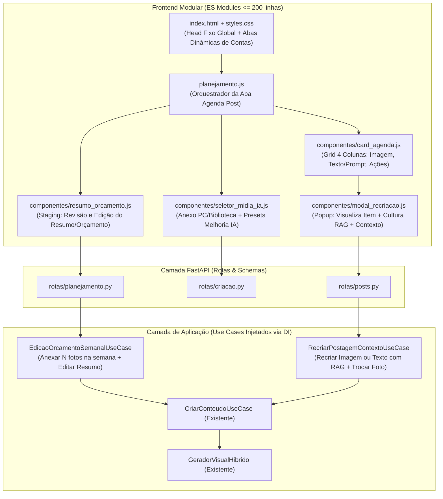

# 📐 Plano Arquitetural e Didático: Aba "Agenda Post" (Robo-Auto-Inst)

> **Status:** Fases 1, 2, 3 e 4 Concluídas e Arquivadas (`132 passed`)  
> **Projeto:** `/home/hermann/Documentos/Pasta_Code/Projetos/Robo-Auto-Inst`  
> **Arquitetura:** Clean / Hexagonal Architecture (FastAPI + Portas & Adaptadores + Vanilla ES Modules Glassmorphic)  
> **Regras Soberanas:** Injeção de Dependência explícita, Componentes Reutilizáveis, TDD/Testes Automatizados e **todos os arquivos `<= 200 linhas`**.

---

## 1. Diagnóstico de Impacto e Mapa de Reaproveitamento

| Módulo / Arquivo Existente | Linhas Atuais | O que já faz hoje | Como será Reaproveitado / Evoluído |
| :--- | :---: | :--- | :--- |
| `app/aplicacao/ia/criar_conteudo.py` | 169 | Orquestra criação de texto (DeepSeek/OpenRouter), imagem IA (`GeradorVisualHibrido`) e rascunho (`Postagem`). | **Reaproveitado 100%** via Injeção de Dependência tanto na **Criação Unitária** (modo prévia `salvar_rascunho=False` e modo final `salvar_rascunho=True`), quanto na execução semanal e na **Recriação Contextual**. |
| `app/aplicacao/ia/geracao_visual.py` | 119 | Já suporta `IA-Cria` (do zero) e `IA-Edita` (`editar_midia_id` em base64 + pipeline Pillow $0). | **Evoluído (~145 linhas):** Aceitar parâmetros de **Presets Fotográficos** (`fullhd`, `foto_profissional`, `iluminacao_hdr`) repassados ao `ProcessadorImagem` e ao prompt da IA. |
| `app/infra/midia/processador_imagem.py` | 135 | Corta `4:5`, `9:16`, `1:1` e ajusta contraste/cor básico. | **Evoluído (~175 linhas):** Adicionar método `aplicar_presets_melhoria(...)` (`UnsharpMask` FullHD, `autocontrast` de iluminação de estúdio, nitidez e vivacidade). |
| `app/aplicacao/ia/planejamento_semanal.py` | 188 | Gera Etapa 1 (proposta + estimativa USD) e Etapa 2 (aprovação + execução). | **Desacoplado:** Para não passar de 200 linhas, as novas operações de **Editar Itens do Resumo/Orçamento** e **Encaixar Imagens Anexadas na Semana** entram em `app/aplicacao/ia/edicao_orcamento_semanal.py`. |
| `app/aplicacao/publicacao/servico_agendamento.py` | **200** | No limite exato de 200 linhas! Cria, agenda, cancela e publica na Meta. | **Preservado em <= 200 linhas:** A funcionalidade de **Trocar Mídia / Recriar Imagem ou Texto com Contexto + Cultura (RAG)** e **Excluir da Agenda (Lixeira)** ficará em um novo caso de uso dedicado `app/aplicacao/ia/recriar_postagem_contexto.py`. |
| `frontend/index.html` | **192** | Topbar atual com 4 abas agrupadas. | **Reestruturado (~175 linhas):** Implementar o **`HEAD FIXO - Todas as páginas`** (`Biblioteca`, `Agenda Post`, `Cultura (RAG)`, `Contas`, `Custos`, `Config`, `◐`, `Sair`) + **Abas Dinâmicas por Conta Vinculada** (`[Gerai_Artes]`, `[...]`) e o layout da aba `Agenda Post`. |
| `frontend/js/planejamento.js` | **197** | No limite de 200 linhas! Mistura planos semanais, criação rápida e cards de post. | **Fatiado (< 120 linhas):** Extrair componentes reutilizáveis para `frontend/js/componentes/` (`seletor_midia_ia.js`, `resumo_orcamento.js`, `card_agenda.js` e `modal_recriacao.js`). |

---

## 2. Diagrama de Arquitetura e Fluxo de Componentes

---

## 3. Explicação Didática de Cada Arquivo (Importações, DI e Lógica)

Abaixo detalhamos didaticamente **cada arquivo novo ou modificado**, suas importações (`imports`), injeções de dependência e funcionamento interno.

---

### 3.1. Back-end: `app/infra/midia/processador_imagem.py` *(MODIFICAÇÃO — De 135 para ~172 linhas)*

- **Finalidade:** Adicionar os filtros ópticos determinísticos ($0 de custo de API) para atender os **Presets de Melhoria de Imagem Anexada**: `fullhd` (nitidez óptica `UnsharpMask` + upscale Lanczos), `iluminacao` (equalização de histograma HDR e brilho) e `foto_profissional` (profundidade de contraste e saturação calibrada).
- **Explicação das Importações:**
  - `from PIL import Image, ImageEnhance, ImageFilter, ImageOps, UnidentifiedImageError`: Adicionamos `ImageFilter` para aplicar `UnsharpMask` (recuperação de definição e bordas para FullHD).
- **Lógica Interna Adicionada:**
  - Método `@classmethod def aplicar_presets_melhoria(cls, img: Image.Image, presets: list[str]) -> Image.Image`:
    - Percorre a lista de presets enviados pelo usuário (`["fullhd", "foto_profissional", "iluminacao"]`) e aplica em cadeia (Padrão *Pipeline/Decorator*) sobre o objeto `Image` antes da serialização JPEG 95%.
  - Integrado ao método existente `otimizar_para_formato` e às estratégias em `estrategias_midia.py`.

---

### 3.2. Back-end: `app/aplicacao/ia/edicao_orcamento_semanal.py` *(NOVO — Estimativa: ~155 linhas)*

- **Finalidade:** Implementar as duas evoluções do **Agendamento Semanal Automático** e da **Mesa de Revisão/Orçamento** sem estourar as 188 linhas de `planejamento_semanal.py`:
  1. Permitir anexar $N$ imagens (ex.: 3 fotos da Biblioteca ou recém-enviadas do PC/Mobile) no Planejamento Semanal para que a IA reconheça cada imagem (`ServicoCuradoriaVisualUseCase`), programe as melhorias (`presets_melhoria`) e encaixe cada foto em um item da grade semanal.
  2. Permitir que o usuário **edite os itens do Resumo/Orçamento** (alterando prompt da imagem, legenda sugerida, formato `IMAGE`/`REELS`/`STORIES`/`CAROUSEL`, horário sugerido ou mídia vinculada) **antes de concluir/executar a geração final para a Agenda**!
- **Explicação das Importações:**
  - `from uuid import UUID`, `from typing import Any`: Tipagem de identificadores e itens JSON da grade.
  - `from app.aplicacao.ia.servico_curadoria import ServicoCuradoriaVisualUseCase`: Injetado para que a IA "enxergue" e descreva as 3 imagens anexadas na semana e saiba como encaixá-las nos posts.
  - `from app.aplicacao.ia.servico_orcamento import ServicoOrcamentoUseCase, estimar_plano_semanal`: Recalcula o orçamento estimado em USD sempre que o usuário altera formatos ou ativa/desativa geração/melhoria de imagem no resumo!
  - `from app.dominio.portas.repositorios_conteudo import ConfigIARepositoryPort, PlanejamentoRepositoryPort`: Portas de repositório injetadas (DIP).
- **Lógica Interna e Métodos:**
  1. `vincular_midias_na_grade(self, empresa_id, conta_ig_id, itens_grade, midia_ids: list[UUID], presets_melhoria: list[str], instrucao_melhoria: str) -> list[dict]`:
     - Para cada `midia_id` anexada pelo usuário (ex: 3 fotos), garante que haja `resumo_visual` (chamando a curadoria Vision se ainda não tiver) e vincula ao item correspondente da grade (`editar_midia_id`, `presets_melhoria`, `ideia_visual`), para que na execução a foto seja melhorada e encaixada no agendamento!
  2. `atualizar_itens_orcamento(self, empresa_id: UUID, conta_ig_id: UUID, plano_id: UUID, itens_editados: list[dict[str, Any]]) -> PlanejamentoSemanal`:
     - Permite ao usuário alterar, diretamente na lista de **Resumo do que foi gerado**, o `tema`, `legenda_previa`, `ideia_visual` (Prompt de Imagem), `formato` (`IMAGE`, `REELS`, `STORIES`, `CAROUSEL`), `horario_sugerido` e `usar_ia_imagem` de cada uma das publicações geradas, recalculando o `custo_estimado_usd` em tempo real antes de concluir!

---

### 3.3. Back-end: `app/aplicacao/ia/recriar_postagem_contexto.py` *(NOVO — Estimativa: ~150 linhas)*

- **Finalidade:** Atender os recursos dos **Cards da Agenda** (parte inferior do wireframe):
  1. **Popup de Recriação com Contexto Adicional + Cultura (RAG):** Acionado pelos botões circulares (`o`) na caixa de `Imagem` ou na caixa de `Texto e Prompt`.
  2. **Substituição rápida de Foto Externa:** Permite trocar a imagem de um card da Agenda por uma foto da Biblioteca ou enviada do PC/Mobile (com opção de aplicar melhoria IA).
  3. **Exclusão definitiva (Lixeira):** Remove o card da Agenda quando desejado.
- **Explicação das Importações:**
  - `from uuid import UUID`: Identificação segura multi-tenant (`empresa_id`, `conta_ig_id`, `postagem_id`).
  - `from app.aplicacao.ia.criar_conteudo import CriarConteudoUseCase`: Reaproveita o motor de criação para regenerar texto ou imagem mantendo o histórico de custos.
  - `from app.aplicacao.ia.dtos import CriarConteudoCmd`: Comando padronizado de geração/edição.
  - `from app.aplicacao.ia.servico_prompts_rag import ServicoPromptsRagUseCase`: Recupera os chunks ativos da **Cultura (RAG)** da conta para injetar na recriação.
  - `from app.dominio.portas.repositorios_conteudo import MidiaRepositoryPort, PostagemRepositoryPort`: Portas de persistência injetadas.
- **Lógica Interna e Métodos:**
  1. `recriar_com_contexto(self, empresa_id: UUID, conta_ig_id: UUID, postagem_id: UUID, alvo: str, contexto_adicional: str, presets_melhoria: list[str] = None, midia_base_id: UUID | None = None) -> Postagem`:
     - Busca a `Postagem` atual e a **Cultura (RAG)** da conta.
     - Se `alvo == "texto"`: Mantém `post.midias_chaves` intacto e pede à IA uma nova legenda/hashtags combinando a legenda anterior + `contexto_adicional` + `Cultura (RAG)`.
     - Se `alvo == "imagem"`: Mantém `post.legenda` intacta e aciona `GeradorVisualHibrido` combinando o prompt visual anterior + `contexto_adicional` + `presets_melhoria` + `Cultura (RAG)` (se `midia_base_id` for informada ou já existir no post, edita/melhora a imagem na pasta `IA-Edita`; caso contrário, recria em `IA-Cria`), atualizando `post.midias_chaves`.
  2. `substituir_midia_postagem(self, empresa_id: UUID, conta_ig_id: UUID, postagem_id: UUID, nova_midia_id: UUID) -> Postagem`:
     - Substitui a imagem do card da Agenda pela foto escolhida da Biblioteca ou recém-subida do PC/Mobile.

---

### 3.4. Evolução nas Rotas e Schemas da API (`<= 200 linhas` cada)

- **`app/api/schemas/criacao_ia.py`** e **`app/api/schemas/postagens_meta.py`:**
  - Adição dos campos opcionais `midia_ids_anexadas: list[UUID] = []` e `presets_melhoria: list[str] = []` em `ProporPlanejamentoRequest` e `CriarConteudoRequest`.
  - Adição de `AtualizarItensPlanoRequest` (para editar os itens no Resumo/Orçamento antes de concluir) e `RecriarPostagemRequest` (`alvo: Literal["imagem", "texto"]`, `contexto_adicional: str`, `presets_melhoria: list[str]`, `midia_base_id: UUID | None`).
- **`app/api/rotas/planejamento.py`** (~145 linhas):
  - Novo endpoint `PATCH /planejamento/{conta_ig_id}/{plano_id}/itens`: Salva as edições feitas pelo usuário nos itens do **Resumo e Orçamento** antes da execução.
- **`app/api/rotas/posts.py`** (~175 linhas):
  - Novo endpoint `POST /posts/{conta_ig_id}/{postagem_id}/recriar`: Executa a recriação de imagem ou texto com contexto adicional + Cultura RAG.
  - Novo endpoint `PATCH /posts/{conta_ig_id}/{postagem_id}/midia`: Troca a imagem do card por foto externa (Biblioteca/PC/Mobile).

---

### 3.5. Front-end: `frontend/index.html` *(MODIFICAÇÃO — ~180 linhas)* e `frontend/css/styles.css` *(MODIFICAÇÃO — ~155 linhas)*

- **Finalidade:** Deixar o layout fiel ao wireframe enviado:
  1. **`HEAD FIXO - Todas as páginas`:** Barra superior fixa com `[Robo-Auto-Inst / Conta]`, `[Biblioteca]`, `[Agenda Post]`, `[Cultura (RAG)]`, `[Contas]`, `[Custos]`, `[Config]`, `[◐]` e `[Sair]`.
  2. **Sub-barra de Abas Dinâmicas por Conta Vinculada (`#abas-contas-dinamicas`):** Logo abaixo do cabeçalho da página `Agenda Posts`, exibe uma aba clicável para cada conta vinculada (ex.: `[Gerai_Artes]`, `[ Outra_Conta ]`), sincronizada com o módulo `Contas`.
  3. **Topo Duplo da Aba `Agenda Post` (`grid-2`):**
     - **Esquerda (`Agendamento Semanal automático`):** Configuração da semana + Componente reutilizável de anexo/melhoria de fotos + Botão de gerar orçamento/resumo + Container **`Resumo do que foi gerado em lista`** (com edição inline antes de concluir).
     - **Direita (`Criação Unitária`):** Seletores de **Tipo (`imagem`, `video`, `texto`)** e **Posicionamento (`post`, `history/stories`, `reels`, `carousel`)** + campo `contexto` + Componente reutilizável de anexo/melhoria de foto + Botão `Gerar` + Container **`Imagem ou texto que foi gerado`** (com revisão, edição e botão de enviar para a Agenda).
  4. **Base da Aba (`Agenda`):** Grade horizontal de 4 colunas (`grid-agenda-4`) contendo os cards com caixa `Imagem` (com botão de foto externa e botão circular `o`), caixa `texto e prompt` (com botão circular `o`) e rodapé `[data e hora]`, `[Postar Agora]` e `[lixeira]`.

---

### 3.6. Front-end: `frontend/js/componentes/seletor_midia_ia.js` *(NOVO — Estimativa: ~125 linhas)*

- **Finalidade:** Componente de UI reutilizável que injeta o painel de **Anexo de Imagem (PC/Mobile ou Biblioteca) + Presets de Melhoria com IA** tanto na **Criação Unitária** (`multiplo: false`), quanto no **Agendamento Semanal Automático** (`multiplo: true`), quanto no **Card da Agenda**.
- **Explicação das Importações:**
  - `import { apiFetch } from "/painel/js/api.js"`: Busca as mídias disponíveis na Biblioteca da conta e realiza upload direto do PC/Mobile (`POST /biblioteca/{contaId}/upload`).
  - `import { el, limpar, notificar } from "/painel/js/dom.js"`: Helpers de criação segura de nós DOM sem `innerHTML`.
- **Lógica Interna:**
  - `export function criarSeletorMidiaIA({ idContainer, obterContaAtiva, multiplo = false, aoMudar })`:
    - Renderiza 3 botões de modo: `🤖 Criar do Zero (IA)`, `💻 Anexar PC/Mobile`, `🗂️ Da Biblioteca`.
    - Quando uma ou mais imagens são anexadas/selecionadas, exibe o painel **"✨ Melhorar Imagem com IA"**:
      - Checkboxes de Presets: `Melhorar Resolução (FullHD)`, `Fotografia Profissional`, `Iluminação Melhorada (HDR)`, `Aplicar Logo da Marca`.
      - Input opcional: *"Instruções extras para melhoria da imagem..."*.
    - Expõe método `.obterEstado()` que retorna `{ modo, midiaIdsSelecionadas, presetsMelhoria, promptExtra }` para o formulário pai.

---

### 3.7. Front-end: `frontend/js/componentes/resumo_orcamento.js` *(NOVO — Estimativa: ~155 linhas)*

- **Finalidade:** Renderizar o **Resumo e Orçamento Editável** tanto no bloco `Resumo do que foi gerado em lista` (Semanal) quanto no bloco `Imagem ou texto que foi gerado` (Unitário).
- **Explicação das Importações:**
  - `import { apiFetch, apiJson } from "/painel/js/api.js"`: Chama os endpoints de atualizar itens do resumo (`PATCH /planejamento/.../itens`), aprovar orçamento e concluir/enviar para a Agenda.
  - `import { el, limpar, notificar } from "/painel/js/dom.js"`: Construção reativa dos cards de revisão.
- **Lógica Interna:**
  - `export function renderizarResumoSemanal(plano, contaId, midiaPorChave, recarregar)`:
    - Exibe cabeçalho: *"📊 Foram criadas X publicações • Orçamento Estimado: $Y USD"*.
    - Lista cada publicação gerada com campos editáveis em tempo real: **Formato (`POST` / `STORIES` / `REELS` / `CAROUSEL`)**, **Horário**, **Tema/Texto**, **Prompt da Imagem (`ideia_visual`)** e miniatura da foto anexada/melhorada.
    - Botões: `💾 Salvar Ajustes no Resumo`, `✅ Aprovar & Concluir (Gerar e Enviar para Agenda)`.
  - `export function renderizarPreviaUnitaria(resultadoPrevia, cmdOriginal, contaId, recarregar)`:
    - Exibe na caixa `Imagem ou texto que foi gerado` a arte gerada/melhorada, o custo em USD, o prompt utilizado e a legenda editável, permitindo revisar ou ajustar qualquer detalhe antes de clicar em **`📅 Concluir e Enviar para Agenda`**.

---

### 3.8. Front-end: `frontend/js/componentes/modal_recriacao.js` *(NOVO — Estimativa: ~135 linhas)*

- **Finalidade:** Implementar o **Popup de Recriação com Contexto Adicional + Cultura (RAG)** acionado pelo botão circular (`o`) na `Imagem` ou no `Texto e Prompt` do Card da Agenda, além do seletor rápido para trocar foto externa.
- **Explicação das Importações:**
  - `import { apiFetch, apiJson } from "/painel/js/api.js"`: Busca as fontes RAG ativas da conta (`GET /contas/{contaId}/rag`) para exibir a Cultura no popup e dispara `POST /posts/{contaId}/{postId}/recriar`.
  - `import { el, limpar, notificar } from "/painel/js/dom.js"`: Construção do modal glassmorphic.
- **Lógica Interna:**
  - `export async function abrirModalRecriacao({ post, alvo, contaId, midiaAtualUrl, promptAtual, aoConcluir })`:
    - Abre modal sobreposto exibindo:
      1. **Visualização do item a ser mudado:** A imagem atual (se `alvo === "imagem"`) ou o texto + prompt atual (se `alvo === "texto"`).
      2. **Bloco Cultura Vinculada (RAG):** Mostra o resumo das diretrizes e conhecimentos ativos da conta (`Cultura RAG`) que guiarão a melhoria.
      3. **Campo de Contexto Adicional + Presets:** Textarea para o usuário digitar o que deseja melhorar (e checkboxes de `FullHD`, `Fotografia Profissional`, `Iluminação` quando o alvo for imagem).
      4. Botão **`✨ Recriar com IA`** que atualiza o card da Agenda e fecha o popup.

---

### 3.9. Front-end: `frontend/js/componentes/card_agenda.js` *(NOVO — Estimativa: ~145 linhas)*

- **Finalidade:** Renderizar cada coluna/card da grade **`Agenda`** (parte inferior do wireframe).
- **Explicação das Importações:**
  - `import { apiFetch, apiJson } from "/painel/js/api.js"`: Aciona agendamento (`/agendar`), publicação imediata (`/publicar-agora`) e lixeira (`/cancelar`).
  - `import { el, notificar } from "/painel/js/dom.js"`: Montagem do DOM do card.
  - `import { abrirModalRecriacao, abrirModalTrocarFoto } from "/painel/js/componentes/modal_recriacao.js"`: Conecta os botões circulares (`o`) e o botão de foto externa.
- **Lógica Interna:**
  - `export function criarCardAgenda(post, contaId, midiaPorChave, recarregar)`:
    - **Bloco Superior (`Imagem`):** Renderiza a imagem/vídeo do post, botão de inserir/trocar foto externa (Biblioteca ou PC/Mobile) e o **botão circular `o`** no canto inferior direito (`alvo: "imagem"`).
    - **Bloco Central (`texto e prompt`):** Renderiza a legenda e o prompt visual com o **botão circular `o`** no canto inferior direito (`alvo: "texto"`).
    - **Bloco Inferior (Barra de 3 Ações):**
      - `[📅 data e hora]` (seletor de agendamento)
      - `[🚀 Postar Agora]` (publicação imediata)
      - `[🗑️]` (lixeira para cancelar/remover da agenda)

---

### 3.10. Front-end: `frontend/js/planejamento.js` *(MODIFICAÇÃO — Reduzido de 197 para ~115 linhas)*

- **Finalidade:** Orquestrar a aba **Agenda Post** injetando os 4 componentes acima (`seletor_midia_ia.js`, `resumo_orcamento.js`, `card_agenda.js`, `modal_recriacao.js`), reduzindo drasticamente o tamanho do arquivo e melhorando a manutenção.

---

## 4. Roteiro de Execução em Fases (Quality Gates & Testes)

1. ✅ **[CONCLUÍDA] Fase 1 — Back-end: Estúdio de Melhoria de Imagem e Edição de Orçamento/Resumo:**
   - Evoluir `app/infra/midia/processador_imagem.py` e `app/aplicacao/ia/geracao_visual.py`.
   - Criar `app/aplicacao/ia/edicao_orcamento_semanal.py` e `app/aplicacao/ia/recriar_postagem_contexto.py`.
   - Rodar suíte `pytest testes/unit/` garantindo 100% de aprovação.
2. ✅ **[CONCLUÍDA] Fase 2 — Back-end: Rotas FastAPI, Schemas e Injeção de Dependência:**
   - Atualizar `app/api/schemas/criacao_ia.py`, `app/api/schemas/postagens_meta.py`, `app/api/dependencias/provedores_ia.py`, `app/api/rotas/planejamento.py` e `app/api/rotas/posts.py`.
   - Rodar testes de integração da API (`132 passed in 11.28s`).
3. ✅ **[CONCLUÍDA] Fase 3 — Front-end: Componentes Reutilizáveis ES Modules (`frontend/js/componentes/`):**
   - Criar `seletor_midia_ia.js`, `resumo_orcamento.js`, `modal_recriacao.js` e `card_agenda.js`.
4. ✅ **[CONCLUÍDA] Fase 4 — Front-end: Layout Wireframe (`index.html`, `styles.css`, `app.js`, `planejamento.js`):**
   - Atualizar o Header Fixo Global, as Abas Dinâmicas por Conta Vinculada e a Aba `Agenda Post` completa.
